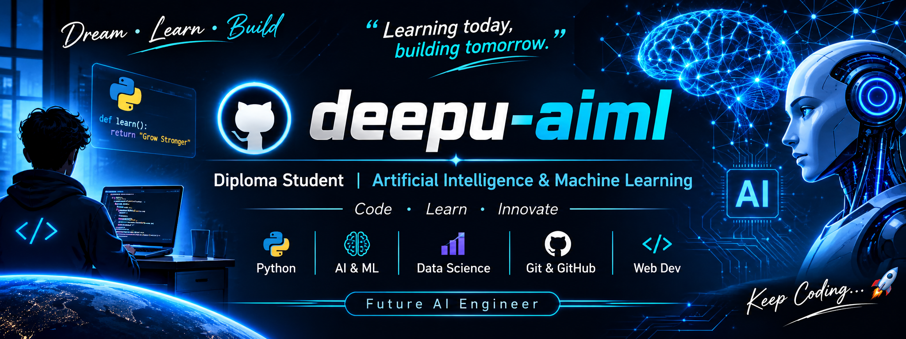

  

 

# Hi, I'm Jaideep 👋

### Diploma Student in Artificial Intelligence & Machine Learning (1st Year)

*Building strong foundations in C and Python, with a goal of becoming a machine learning engineer.*

  
  
  

---

## 👨‍🎓 About Me

I am a first-year Diploma student specialising in **Artificial Intelligence and Machine Learning** at **MRS A.V.N Polytechnic College**. I am starting from the fundamentals, learning **C** and **Python**, and I plan to use this profile to document my progress and share the projects I build along the way.

- 🎯 **Goal:** Grow into a capable ML engineer through consistent practice and real projects
- 📚 **Learning now:** C programming and Python programming
- 🤝 **Looking for:** Study partners, beginner-friendly projects and mentorship
- 🌱 **Approach:** Learn step by step, build small projects, and keep everything on GitHub

---

## 🎓 Education

| Programme | Institution | Duration |
|-----------|-------------|----------|
| Diploma in Artificial Intelligence & Machine Learning | MRS A.V.N Polytechnic College | 2026 – 2029 |

**Subjects this year:** C Programming · Python Programming

---

## 💻 Programming Languages

*Currently learning and practising*

---

## 🛠️ Tools I Use

---

## 🚀 Projects

My first projects are on the way. These are the beginner projects I plan to build as I learn:

| Project | Language | Status |
|---------|----------|--------|
| Simple calculator | C | 📝 Planned |
| Number guessing game | Python | 📝 Planned |
| Student marks and grade calculator | Python | 📝 Planned |

Each finished project will be added as its own repository with a README and clear instructions to run it.

---

## 📈 Learning Roadmap

- [ ] C programming fundamentals (variables, loops, functions, arrays)
- [ ] Python programming fundamentals (data types, control flow, functions)
- [ ] Build and publish my first three small projects on GitHub
- [ ] NumPy and Pandas for data handling
- [ ] Data visualisation with Matplotlib
- [ ] Mathematics and statistics essentials for ML
- [ ] Machine learning basics with scikit-learn

---

## 📊 GitHub Stats

---

## 📫 Contact

---

*Every expert was once a beginner.*

⭐ Feel free to follow my journey and explore my repositories.

